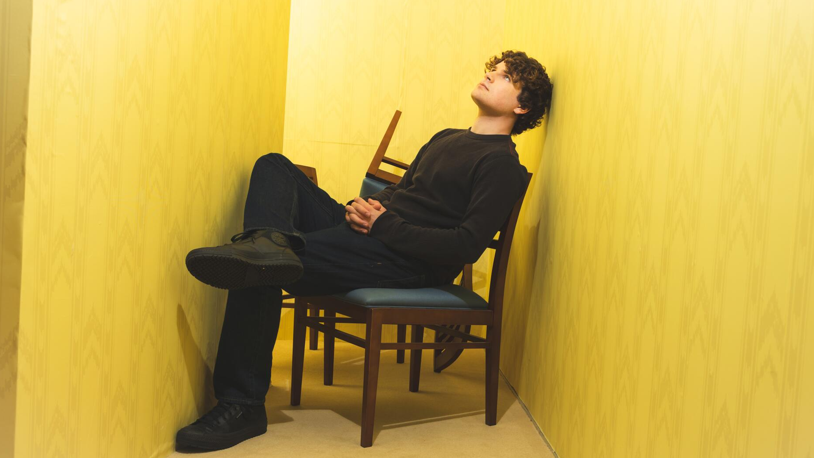
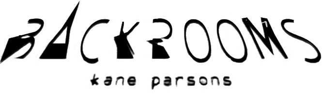
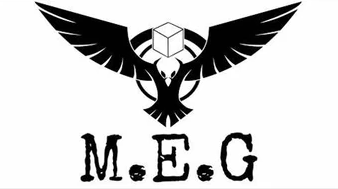
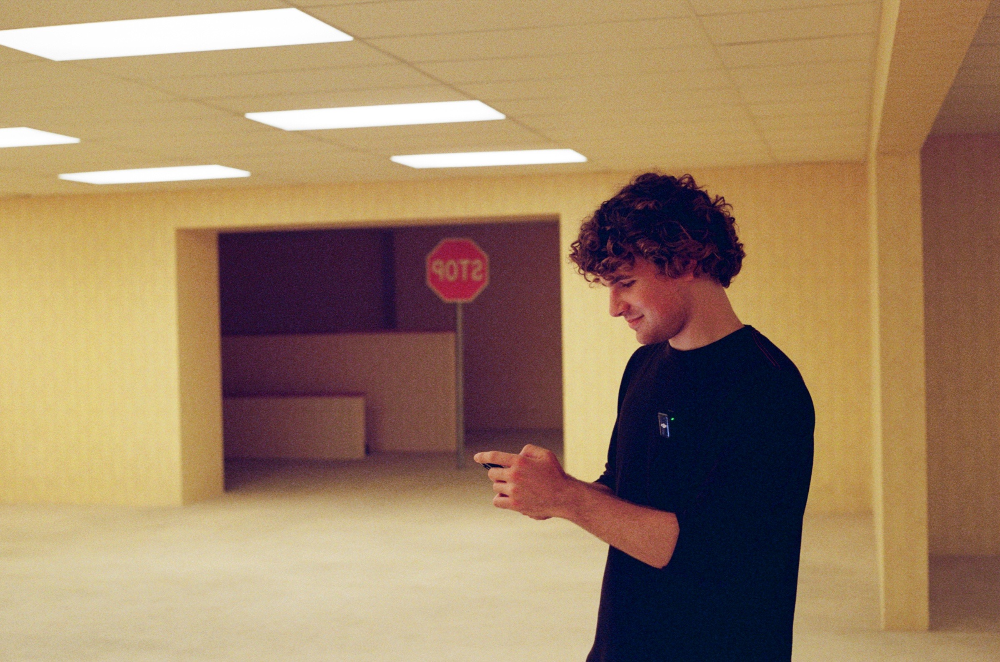

$${\color{#e8c827}\Huge{\texttt{hello there!!}}}$$
<!-- Centered and resized GIF -->

  

  
   
  <!-- Your LaTeX colored text directly below -->
  $${\color{#e8c827}sometimes\space rarely\space updated\space because\space i\space need\space to\space study\space😓}$$

  
  $${\color{#e8c827}this\space profile\space is\space used\space for\space all\space the\space visitors\space to\space contact\space and\space check\space out\space a\space custom\space page\space that\space are\space completely\space made\space by\space human!\space and\space please\space sign\space in\space atabook!!}$$

you can find me in pony town, sometimes i'll sit near the libary! go ahead and say hello to me! but i might be busy so i might won't chat back :)
    
  
<table>
  <tr>
    <!-- Left Column: Info & Colors -->
    <td width="50%" valign="top">
      <h3>Profile Info</h3>
      
<b>Age & Pride Flags</b> I am 15 years old and I'm a demigirl, non-binary, and lithsexual.

      
<b>Favorite Colors</b> Yellow and bright green

    </td>
    <!-- Right Column: Likes & Dislikes -->
    <td width="50%" valign="top">
      <h3>likes and dislikes</h3>
      
<b>Likes</b> Supportive people, helpers, true friends, and kind people

      
<b>Dislikes</b> I don't like MAPs, zoophiles, homophobic people, and predators because they are disgusting.

    </td>
  </tr>
</table>
   

<!-- Centered and resized GIF -->

  

  

  <!-- Your LaTeX colored text directly below -->
  $${\color{#d9b814}me\space as\space a\space ESFP-a,\space plus\space people\space i\space react\space to}$$
 

<mark><i>As an ESFP-A people!, my relationships with people and how I interact with the social world are defined by a mix of real time adaptability, unshakeable confidence, and a deep, intuitive appreciation for absolute authenticity. When I am interacting with supportive, open-minded, and kindful individuals, my natural response is to be completely present in the moment sharing my high energy, building a safe haven for good vibes, and matching their warmth step-for-step. I react to true friends and genuine helpers with an unwavering, fierce loyalty, always looking for spontaneous ways to encourage them, celebrate their wins, and lift them up whenever they need a trusted ally by their side. At the same time, being an assertive personality type gives me the unique emotional strength to navigate difficult, complicated, or hostile social situations without absorbing other people's negative traits or letting them ruin my day. When faced with judgmental, unsafe, or harmful mindsets, such as homophobia, hostility, or predatory behaviors. my reaction is swift, incredibly clear, and entirely uncompromising. I firmly shut out the background noise, refuse to tolerate any form of disrespect, and confidently maintain a peaceful, secure environment for myself and the community I care about. I choose to invest my heart and energy entirely in uplifting, honest relationships that celebrate mutual kindness, moving forward with an optimistic mindset and keeping my social circle focused strictly on positivity</i></mark>

###  online Schedule and Activity + atabook
 

  • Weekdays: Mostly online during the evenings 
  • Weekends: Flexible timing throughout the day and night 
  • Atabook Status: Checked routinely when active 
  • do not ask: sexual things and weird things
 
[GMT+7 timezone]
 

  

  

| Attribute | Details |
| :--- | :--- |
| **true nickname** | anlas |
| **Location** | 📍 nakhon pathom, thailand |
| **Current Focus** | learning about making more codes |
| **Pronouns** | 💬 they / them |
| **Interests** | fossils, puzzles and more songs |

  

<!-- Centered profile photo with fixed width -->

  

---

  
<b>backrooms OST</b>

  

<i>Click the image!!!</i>

  <!-- Your LaTeX colored text directly below -->
  $${\color{#63511A}still\space work\space in\space progress!}$$

